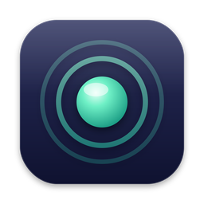

<p align="center">
  
</p>

<h1 align="center">AgentSessionNotifier</h1>

<p align="center">
  Keep track of your Claude Code sessions from the macOS menu bar.<br>
  Get notified when Claude needs your approval or finishes a response.
</p>

---

## Features

- **Menu bar status:** empty ring (idle), filled circle (running), half-filled ring with a count (needs approval), checkmark (done)
- **Notifications:** when Claude asks for permission and when it finishes; the "done" notification includes a summary of Claude's last reply
- **Jump back:** click a notification or a session in the list to bring its terminal to the front (Terminal, iTerm, Warp, Ghostty, WezTerm, VS Code…)
- **Session names:** shows the name set with `/rename` or Claude's automatic title, next to the project folder
- **Right-click a session:** show in Finder, copy the path, remove from the list
- **Nothing is missed:** events that arrive while the app is closed are processed when it opens (without notifications for old events)
- **Menu bar app:** no Dock icon; optional launch at login

## Requirements

- macOS 14 Sonoma or later
- [Claude Code](https://docs.claude.com/en/docs/claude-code)
- Xcode or the Command Line Tools (`xcode-select --install`) to build

## Installation

```bash
git clone https://github.com/ferenozcelik/agent-session-notifier.git
cd agent-session-notifier
./build.sh --install
```

This builds the app, copies it to `/Applications` and launches it. You can also double-click `Install.command`.

Then:

1. Allow notifications when macOS asks.
2. Click the menu bar icon → **Install Hooks**.

Hooks take effect in Claude Code sessions started **after** installation.

## How it works

```
Claude Code hook  →  hook.sh  →  ~/Library/Application Support/AgentSessionNotifier/events/*.json  →  app
```

**Install Hooks** adds global hooks to `~/.claude/settings.json` for `SessionStart`, `UserPromptSubmit`,
`PostToolUse`, `Notification`, `Stop` and `SessionEnd`. Your other hooks are left untouched, and the file is
backed up as `settings.json.agentsessionnotifier-backup` before every change.

The hook script drops each event into a folder as a JSON file and exits immediately, so it never slows Claude down.
The app watches the folder, processes events in order and deletes them. Sessions with no activity for 24 hours
drop off the list.

## Uninstall

1. Click the menu bar icon → ⚙︎ → **Uninstall Hooks**.
2. Quit the app and delete `/Applications/AgentSessionNotifier.app`.
3. Optionally remove `~/Library/Application Support/AgentSessionNotifier`.

## Privacy

AgentSessionNotifier has no network access. Session data stays on your Mac.

## License

Released under the [MIT License](LICENSE).

AgentSessionNotifier is an independent project and is not affiliated with or endorsed by Anthropic.
